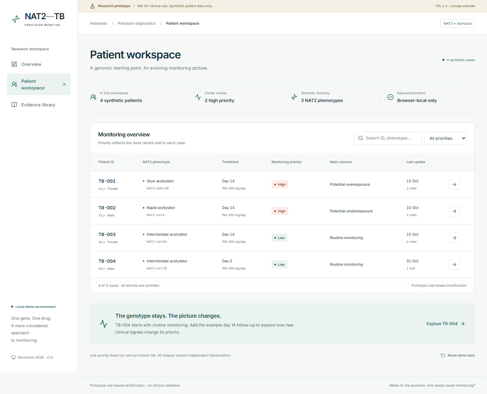
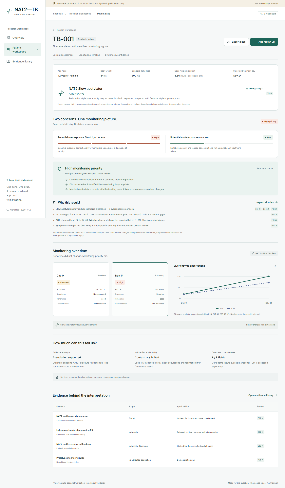
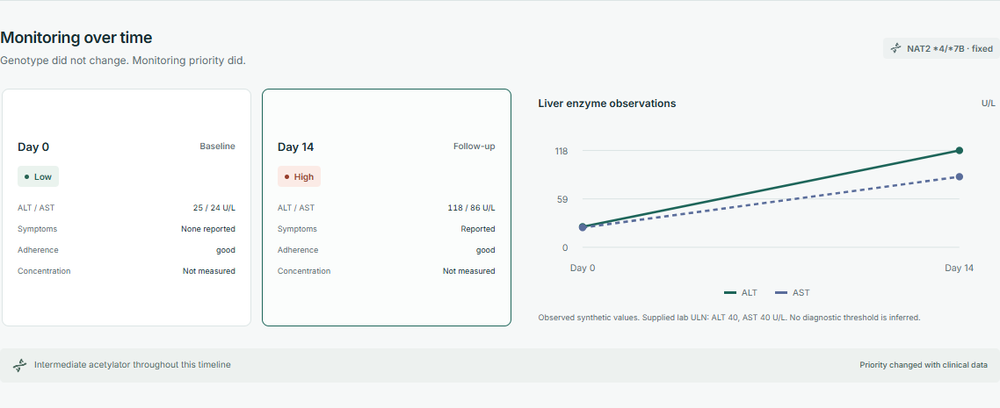
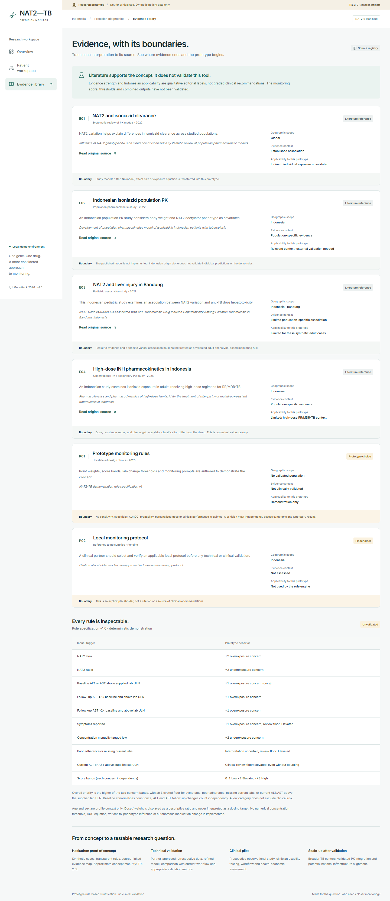

# NAT2-TB Precision Monitor

**Who needs precision monitoring most?** A local proof of concept for pharmacogenomics-guided, risk-adaptive monitoring during isoniazid therapy in Indonesian tuberculosis care.

> **Research prototype — not for clinical use.** All patients are synthetic. The app uses prototype rule-based risk stratification for demonstration purposes. No diagnosis, dose recommendation, exposure prediction or clinical performance is claimed.

## Problem

NAT2 variation can affect isoniazid metabolism. Slow and rapid acetylators can present different exposure concerns, while clinical monitoring needs evolve during treatment. One-size-fits-all monitoring may miss opportunities to prioritize attention. The literature supports investigation of this concept; it does not establish that this tool improves clinical outcomes.

## Solution

Explore independent potential overexposure/toxicity and underexposure concerns, inspect every rule and its evidence, and add follow-up observations to update the monitoring picture. Genotype stays fixed while monitoring priority can change. The innovation demonstrated here is risk-adaptive precision monitoring with explicit evidence applicability, rather than NAT2-guided dosing.

## Why Indonesia

Indonesia faces a substantial TB burden. Indonesian NAT2 and population pharmacokinetic evidence exists, offering a basis for local research. In settings with constrained monitoring resources, prioritization is a useful research question. No national prevalence, effect size or performance figure is assumed. See the [WHO country profile](https://data.who.int/countries/360) for country context and the source-linked evidence registry below for study populations and limitations.

## Run locally

Prerequisites: Node.js 22 LTS or newer and npm. No Docker, database, API key or environment file is needed. Network is needed to install packages; fonts and all runtime data are bundled locally.

```bash
npm install
npm run dev
```

Open **http://localhost:3000**. The server binds to the local loopback interface only. If port 3000 is occupied, Next.js reports a different port; use its printed URL.

If Windows reserves port 3000 (`EACCES`), use `npm run dev -- --port 3001` and open **http://localhost:3001**. This machine required that alternative during verification. The scripts use Webpack to avoid a Turbopack subprocess restriction in the build environment.

For a production build:

```bash
npm run build
npm start
```

## Explore the prototype

| Route              | Purpose                                                                       |
| ------------------ | ----------------------------------------------------------------------------- |
| `/`                | Overview and conceptual explanation                                           |
| `/patients`        | Search and filter four synthetic cases; reset local demo data                 |
| `/patients/TB-001` | Slow acetylator with rising enzymes and reported symptoms                     |
| `/patients/TB-002` | Rapid acetylator with a low, manually tagged concentration                    |
| `/patients/TB-003` | Intermediate acetylator with stable follow-up                                 |
| `/patients/TB-004` | Intermediate acetylator: add day 14 to demonstrate escalation                 |
| `/evidence`        | Literature references, applicability boundaries, exact demo rules and roadmap |

On TB-004, choose **Add follow-up → Fill day 14 demo → Save follow-up & update priority**. The state changes from Low to High without any genotype change. Select Day 0 or Day 14 in the timeline to inspect historical assessments. Export case downloads synthetic observations and the selected assessment as JSON.

Follow-ups persist in this browser's localStorage. They are not sent to a server and do not synchronize across browsers. Reset demo data on the dashboard restores all original cases after inline confirmation. Do not enter real patient data. If browser storage is blocked or malformed, the UI explains the limitation and offers the original demo cases.

## Scientific boundaries

- NAT2 phenotype and diplotype are preassigned synthetic examples; no variant interpretation pipeline is implemented.
- Rule weights, lab doubling triggers and score bands are illustrative design choices. They are not derived clinical thresholds or validated prediction equations.
- Liver enzymes and symptoms are nonspecific. Their inclusion demonstrates monitoring escalation and does not establish exposure, toxicity, causality or drug-induced liver injury.
- Dose/weight is a descriptive ratio; age and sex are profile context. None of these changes the score or sets a dosing target.
- Optional INH concentrations require a measurement and sampling time. The interpretation is manually tagged; no numerical therapeutic threshold is applied.
- Missing current labs, symptoms or poor adherence can warrant review. Missing observations are not filled with normal values.
- Evidence strength and Indonesian applicability are qualitative editorial descriptions, not validated clinical confidence scores. Completeness is an explicit count of eight core fields; optional TDM absence remains an uncertainty.
- No medication change, authentication, hospital integration, real genomic data, LLM or external backend is included.

## Evidence

All citations and the explicit local-protocol placeholder live in **`src/data/evidence.ts`**. Reference metadata and broad findings were checked against accessible published records during implementation (15 October 2026); this is not a systematic literature appraisal. The source titles and direct URLs are also available in the app.

- [NAT2 and isoniazid clearance: systematic review of population PK models (2022)](https://pmc.ncbi.nlm.nih.gov/articles/PMC9482569/)
- [Indonesian population PK model (2022)](https://www.ijidonline.com/article/S1201971222000042/fulltext)
- [NAT2 and pediatric anti-TB hepatotoxicity in Bandung (2021)](https://pmc.ncbi.nlm.nih.gov/articles/PMC8184287/)
- [High-dose isoniazid PK/PD in Indonesian RR/MDR-TB (2024)](https://pmc.ncbi.nlm.nih.gov/articles/PMC11062943/)

Pediatric evidence and high-dose RR/MDR-TB evidence have explicit transfer limitations for these synthetic adult cases. No published model is implemented. The placeholder is not used as a rule source. Clinical partner review and a selected local monitoring protocol are prerequisites for validation work.

## Verification

```bash
npm test
npm run typecheck
npm run build
```

The unit suite covers the required scenarios, historical assessments, missingness, adherence confounding, lab boundaries, independent concern bands and follow-up validation.

For browser checks and screenshots, start the local app first, then:

```bash
npx playwright install chromium
npm run test:browser
```

The browser check covers navigation, filtering, follow-up escalation, persistence, historical state, missing data, reset, case export, invalid routes, mobile overflow and browser errors. Set `BASE_URL` for a different port, or `BROWSER_EXECUTABLE` to reuse an installed Chromium-family browser. The script resets its isolated browser context; it does not clear the user's browser.

## Screenshots

Captured from the running app using synthetic cases. All files are in `docs/screenshots/`.

**Patient dashboard**



**High-priority patient detail**



**Longitudinal change**



**Evidence library**



## Structure

```text
src/app/          Routes and clinical visual system
src/components/  Workspace, detail, follow-up, timeline and evidence UI
src/data/        Synthetic cases and single citation registry
src/lib/         Deterministic risk engine and browser-local store
src/types/       Patient and visit contracts
tests/           Rule and input validation tests
scripts/         Browser verification and screenshot capture
docs/            Original brief, proposal notes and screenshots
```

## Research roadmap

1. **Hackathon:** source-backed concept, synthetic cases, transparent demonstration and evidence map.
2. **Technical validation:** approved retrospective data, model refinement, workflow comparison and appropriate sensitivity/specificity/calibration assessment.
3. **Clinical pilot:** prospective observational study, clinician usability, workflow integration and health-economic evaluation.
4. **Scale-up after validation:** broader TB centers, validated PK integration and potential national infrastructure integration.

Conservative concept maturity estimate: **TRL 2–3**. This is not a certification or claim of clinical validation. Team members and institutional or partner support must be confirmed independently.

## Push to your future GitHub repository

This folder is its own Git repository with a `main` branch. Create an **empty** GitHub repository, then run these commands from this folder, replacing `YOUR-REPO`:

```bash
git remote add origin https://github.com/SimforianusJonathan/YOUR-REPO.git
git push -u origin main
```

Suggested repository description: _Pharmacogenomics-guided risk-adaptive monitoring prototype for isoniazid therapy in Indonesian tuberculosis care._
